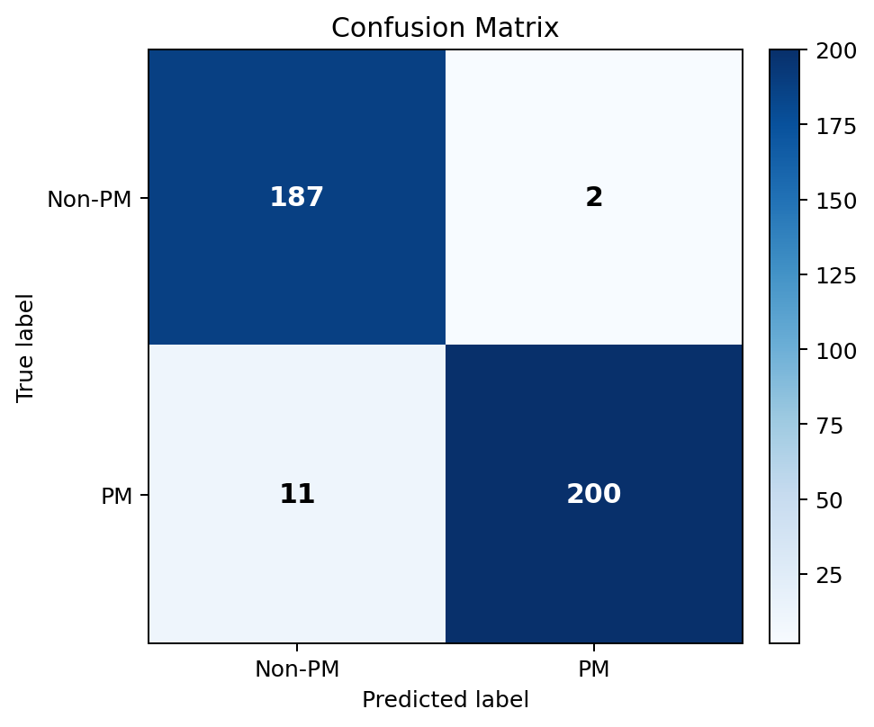

# PALM 病理性近视识别

基于 EfficientNet-B3 和眼底彩照的病理性近视（Pathological Myopia, PM）二分类项目。项目使用 PALM Challenge 数据集，提供可复现的训练、官方验证集评估和单张图像推理流程。

> 本项目仅用于学习与研究展示，不能用于医疗诊断或替代专业医生的判断。

## 项目亮点

- 将 PALM 官方分类任务建模为 `PM / Non-PM` 二分类，避免使用没有训练样本的虚假类别。
- 训练集按标签分层划分，随机种子固定为 42，方便复现。
- 训练增强和验证预处理完全分离，防止验证结果受随机增强干扰。
- 同时报告 Accuracy、Precision、Recall、F1 和 ROC-AUC，不只依赖准确率。
- 在未参与训练的 PALM 官方验证集上进行独立评估。
- 模型文件保存类别定义、图像尺寸、随机种子、训练轮次和内部验证指标。

## 技术栈

Python · PyTorch · Torchvision · EfficientNet-B3 · scikit-learn · Pandas · Matplotlib

## 数据集与标签

数据来自 [PALM: PAthoLogic Myopia Challenge](https://palm.grand-challenge.org/Home/)。本仓库不再分发原始眼底图像，请按官方要求申请和下载数据，并遵守其参与规则。

训练图像的文件名前缀映射为：

| 前缀 | 原始含义 | 二分类标签 |
| --- | --- | --- |
| `P` | Pathological Myopia | 1 / PM |
| `N` | Normal | 0 / Non-PM |
| `H` | High Myopia | 0 / Non-PM |

引用数据集时请使用官方提供的文献信息：

> Fu, H. et al. PALM: PAthoLogic Myopia Challenge. IEEE DataPort (2019). DOI: 10.21227/55pk-8z03.

## 目录结构

```text
eye_disease_project/
├── src/
│   ├── data.py          # 数据发现、标签映射和 Dataset
│   ├── model.py         # EfficientNet-B3 模型
│   ├── metrics.py       # 指标与可视化
│   ├── train.py         # 训练与内部验证
│   ├── evaluate.py      # 官方验证集评估
│   └── predict.py       # 单图推理
├── tests/
│   └── test_data.py
├── artifacts/               # 指标、预测结果与图表
├── requirements.txt
└── README.md
```

## 安装

```bash
python -m venv .venv
# Windows
.venv\Scripts\activate
# macOS / Linux
source .venv/bin/activate

python -m pip install -r requirements.txt
```

## 数据放置

下载后可保持官方目录名，例如：

```text
PALM-Training400/PALM-Training400/*.jpg
PALM-Validation400/*.jpg
PALM-Validation-GT/PM_Label_and_Fovea_Location.xlsx
```

## 训练

在项目根目录执行：

```bash
python -m src.train \
  --data-dir PALM-Training400/PALM-Training400 \
  --epochs 8 \
  --batch-size 8
```

默认将最佳模型保存到 `artifacts/checkpoints/best_model.pth`，并生成训练曲线、混淆矩阵和指标文件。

## 官方验证集评估

```bash
python -m src.evaluate \
  --images-dir PALM-Validation400 \
  --labels-xlsx PALM-Validation-GT/PM_Label_and_Fovea_Location.xlsx
```

### 独立验证结果

使用 400 张未参与训练的 PALM 官方验证图像和官方标签评估。训练集内部按 8:2 分层划分，以内部验证 F1 选择最佳权重；官方验证集不用于训练或模型选择。

| 指标 | 结果 |
| --- | ---: |
| Accuracy | 96.75% |
| Precision | 99.01% |
| Recall | 94.79% |
| F1 | 96.85% |
| ROC-AUC | 99.67% |

混淆矩阵显示：189 张 Non-PM 图像中正确识别 187 张，211 张 PM 图像中正确识别 200 张。



详细的机器可读汇总指标和训练记录位于：

- `artifacts/official_validation/metrics.json`
- `artifacts/training_history.csv`

为避免公开逐图医学分类结果，逐图预测表仅保留在本地，不纳入公开仓库。

## 单张图像推理

```bash
python -m src.predict path/to/fundus.jpg
```

## 与旧版课程实验的区别

旧 Notebook 是课程探索过程，包含硬编码本地路径、多次临时修复和不匹配的五类输出。本版保留了迁移学习思路，但将数据定义、训练、评估和推理拆分为独立模块，并用官方验证标签给出可核验结果。

## 局限性

- 数据规模有限，模型在不同设备、人群和图像质量上的泛化能力仍需外部验证。
- 模型只输出 PM 风险分类，不提供病灶分割或临床可解释结论。
- 结果受数据划分、随机种子、超参数和预训练权重影响，应结合完整配置理解。

